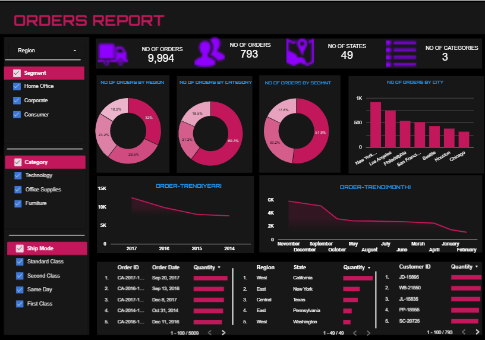

# Orders-Report-Looker-Studio

An interactive Google Looker Studio dashboard for analyzing order performance, customer segments, sales trends, product categories, and geographical insights.

## 🔗 Live Dashboard

[**Click Here to View the Interactive Orders Report Dashboard**](https://datastudio.google.com/reporting/679b6e72-2dde-4a36-98ee-0fe3cf5c9aef)

## Dashboard Preview



## Project Overview

This project focuses on analyzing an e-commerce Superstore dataset and transforming raw business data into an interactive dashboard using Google Looker Studio.

The dashboard provides insights into order distribution, customer segments, product categories, regional performance, city-wise orders, and order trends over time.

## Tools & Technologies

- Google Looker Studio (Data Studio)
- Microsoft Excel
- Data Visualization
- Business Intelligence
- Interactive Filters and Controls

## Dashboard Features

### 1. Key Performance Indicators (KPIs)
Displays key metrics such as:
- Number of Orders
- Customer-related Order Count
- Number of States
- Number of Product Categories

### 2. Regional Analysis
Visualizes order distribution across different geographical regions.

### 3. Category Analysis
Analyzes orders across:
- Technology
- Office Supplies
- Furniture

### 4. Customer Segment Analysis
Compares:
- Consumer
- Corporate
- Home Office

### 5. City-wise Order Analysis
Highlights cities with the highest order counts.

### 6. Year-wise Order Trends
Visualizes order activity across different years.

### 7. Month-wise Order Trends
Analyzes monthly order patterns.

### 8. Detailed Data Tables
Displays order details, regional information, state-wise quantities, and customer information.

## Interactive Features

The dashboard includes interactive filters for:

- Region
- Customer Segment
- Product Category
- Shipping Mode

These filters allow users to explore the data across different business dimensions.

## Dataset Description

The dataset contains the following information:

- Row ID
- Order ID
- Order Date
- Ship Date
- Ship Mode
- Customer ID
- Customer Name
- Segment
- Country
- City
- State
- Postal Code
- Region
- Product ID
- Category
- Sub-Category
- Product Name
- Sales
- Quantity
- Discount
- Profit

## Key Business Objectives

- Analyze order distribution across geographical regions.
- Understand customer segment behaviour.
- Compare product category performance.
- Identify cities with higher order volumes.
- Examine yearly and monthly order trends.
- Present business data through interactive visualizations.

## Project Structure

```text
Orders-Report-Looker-Studio/
│
├── README.md
├── dashboard_preview.png
└── Data_Source.xlsx
```

## How to Access the Dashboard

1. Click the Live Dashboard link provided above.
2. Explore the charts and visualizations.
3. Use the available filters to analyze specific regions, customer segments, categories, and shipping modes.
4. Interact with the report to explore business insights.

## Project Category

Data Analytics | Business Intelligence | Google Looker Studio | Data Visualization
